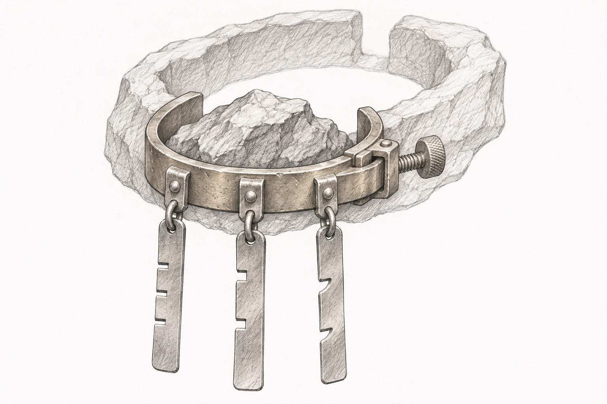

# Rezonator progu

## Do pokazania graczom

Pokaż rysunek, kiedy bohaterowie opracują projekt albo po raz pierwszy zobaczą złożony przyrząd. Przy projekcie przeczytaj pierwszy akapit. Przy gotowym urządzeniu przeczytaj drugi.

### Szkic

> Na papierze widzicie obrys obejmy i trzy cienkie blaszki, każdą zawieszoną na osobnym zaczepie. Przy krawędziach blaszek zaznaczono drobne nacięcia. Między blaszkami zostawiono tyle miejsca, by każda mogła drgać swobodnie. Wewnętrzny łuk obejmy jest gładki i otwarty, żeby można go było nasunąć na kamienny kołnierz.

### Gotowy przyrząd

> Na mosiądzu widać świeże rysy po pilniku. Trzy cienkie blaszki wiszą na osobnych zaczepach. Wystarczy musnąć krawędź jednej z nich, by odezwała się dźwiękiem tak cienkim, że bardziej czuć go w opuszce palca, niż słychać. Od strony kamienia obejma ma gładkie, starannie dopasowane wygięcie.

## Dla MG

### Skąd wziąć części i wzorce

- **Wzorce brzmienia.** W Monastyrze Trzech Źródeł D3 i D4 prowadzą do próby z misami. Po jej rozwiązaniu archiwista daje trzy cienkie, nacięte blaszki używane do ich strojenia. Jeśli drużyna ominęła archiwum, po zbadaniu progu górnik może wskazać zduna Gildii Srebrnego Młota z odpisami D3 i D4. Elira lub Seweryn mogą też zdobyć odpisy na prośbę bohaterów.
- **Mosiężna obejma.** Woźnica może ją oddać po ratunku na rozstajach. W warsztacie Gildii są dwie zapasowe. Gildia może również pomóc dopasować zaczepy. Kael może rozrysować mocowanie, a Moss dostroić blaszki do pulsu, jeśli gracze zechcą tak podzielić pracę.
- **Dopasowanie do progu.** W S5 daj D6, rycinę kamiennego progu. Stuknięcie, nucenie lub przyłożenie kryształu wywołuje jedną widoczną odpowiedź. Śledztwo albo Wiedza tajemna **ST 13** pozwala szybko ocenić, jak długo podtrzymać pierwszą odpowiedź. Po porażce spokojna próba daje ten sam pomiar po dziesięciu minutach w grze.

### Kiedy go użyć

- **Sesja 2.** Jeśli bohaterowie mają na razie wzorce z Monastyru, rysunek może być finałem pracy nad projektem. Jeśli zdążyli również zbadać próg i potrafią odtworzyć trzy właściwe odpowiedzi, mogą go otworzyć już podczas tego spotkania. Liczy się działająca metoda podtrzymania odpowiedzi, także gdy gracze wymyślą własną.
- **Sesja 3 lub później.** Wróć do brakującego kroku. Jeśli poprzednio powstał szkic, zacznij od złożenia albo dopasowania urządzenia. Po otwarciu progu wznów grę od decyzji o przekroczeniu przejścia lub od miejsca, w którym drużyna przerwała badanie Węzła Wody.

### Próba przy progu

1. Wzorzec **niebieski (księżyc) → zielony (liść) → biały (kość)** wynika z połączenia D3 i D4. Pierwsza blaszka ma nadal drgać, kiedy odezwie się druga, a obie kiedy odezwie się trzecia. Kamień musi otrzymać wszystkie trzy odpowiedzi w tym samym czasie po wzbudzeniu ich w tej kolejności.
2. Pokaż wynik drganiem lub zanikaniem śladów w bruzdach. Przy błędzie gaśnie ostatni ślad i próbę można ponowić. Gdy się uda, pokaż otwarte przejście i daj usłyszeć wodę za ścianą.
3. Bohaterowie osobno decydują, czy przejdą przez próg, a po dotarciu do Węzła Wody, czy uruchomią jego obieg. Kompas Głębi służy do nawigacji między aktywnymi węzłami. Późniejszy siedmioczęściowy Klucz Rezonansu rozwija zasadę tego prototypu.

[Księga MG, s. 6, 9 i 12](a4/01_Ksiega_MG.pdf#page=9) · [Handouty D3, D4 i D6](a4/02_Dokumenty_dla_graczy.pdf#page=3) · [Kompendium kampanii, s. 13 i 17](../kampania/mg/Tajemnice_Tess_Kampania_przy_stole.pdf#page=13)
